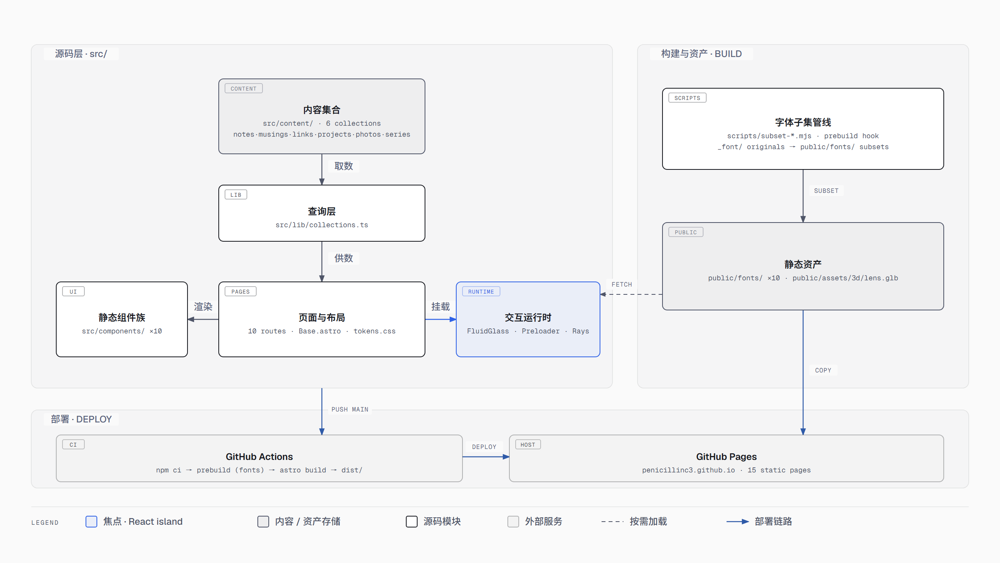

# PenicillinC3 的个人博客

Apple 液态玻璃风格的静态个人站点。包含我的一些思考见解，学习心得，摄影作品展示，个人项目等内容。

内容全部是 Markdown 文件，推送到 GitHub 即自动构建部署到 GitHub Pages。

技术：Astro 5 · TypeScript · 纯 CSS（React 仅首页玻璃球一个 island，spec §69 特批；其余零框架）。设计依据见 `docs/superpowers/specs/`，实现计划见 `docs/superpowers/plans/`。

## 本地开发

本项目由Claude Code搭配Deepseek-v4.1-flash协助开发。设计决策与实现过程见 `docs/superpowers/specs/`（设计权威，后节覆盖先节）与 `docs/superpowers/plans/`（历史实现计划）。

```bash
npm install     # 首次
npm run dev     # 开发服务器（热更新），Ctrl+C 退出
npm run build   # 构建到 dist/
npm run preview # 本地预览构建产物
```

## 日常更新

参见博客个人笔记中的**本站内容写作与发布教程**。

## 部署（GitHub Pages）

已上线：仓库 `PenicillinC3/PenicillinC3.github.io`。

每次推送 `main`，Actions（`.github/workflows/deploy.yml`）自动 `astro build` 并发布到 Pages，无需任何手动步骤。

*详细内容请参见博客个人笔记中的更新与删除网页教程*

## 项目结构



源码层：`src/content/`（六个内容集合：notes / musings / links / projects / photos / series）经 `src/lib/collections.ts`（唯一取数入口）供数给 `src/pages/`（十条路由）与 `src/layouts/`、`src/styles/`；页面调用 `src/components/` 的静态组件族（零框架）与三个交互运行时（FluidGlass 玻璃球 island、Preloader 加载页、Rays 射线 —— 全站仅有的 JS/WebGL）。字体子集管线（`scripts/subset-*.mjs`，prebuild 钩子自动跑）从 `_font/` 原件产出 `public/fonts/` 子集。推送 main → GitHub Actions 构建 → GitHub Pages 发布。

## 内容许可

本博客遵循 CC BY-NC 4.0 协议。
